# Tonal

A personal, offline-first music player for Android, built on a revived and modernized copy of **Minima Player** by BKR APPS.

> **Status:** unofficial, non-commercial fork of Minima Player. Own code under the MIT License; see [Licence and credits](#licence-and-credits).
> **Credit:** Based on Minima Player by BKR APPS. All original design and code belong to their author. Tonal exists because the original app was abandoned and stopped working on current Android versions.

## Screenshots

Screenshots use generated sample covers and placeholder titles.

| Home | Player | Queue |
|---|---|---|
| 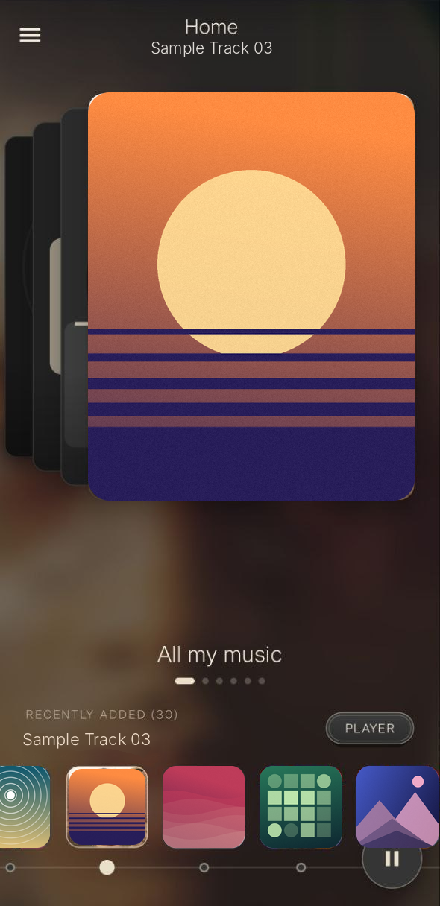 | 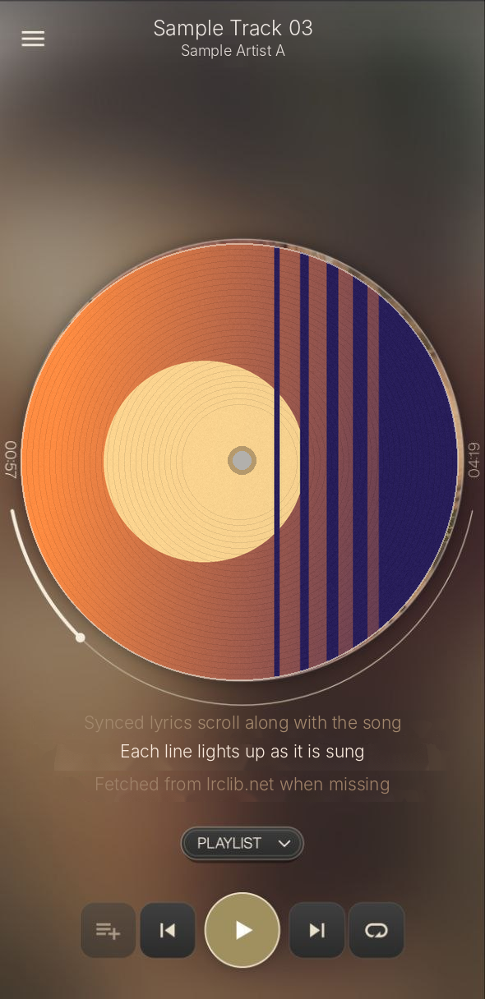 | 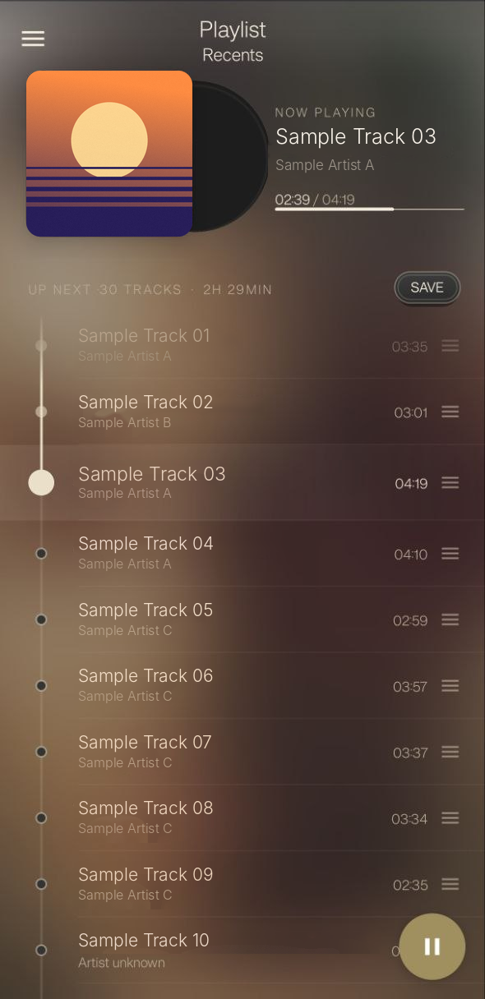 |

| Songs | Albums | Folders |
|---|---|---|
| 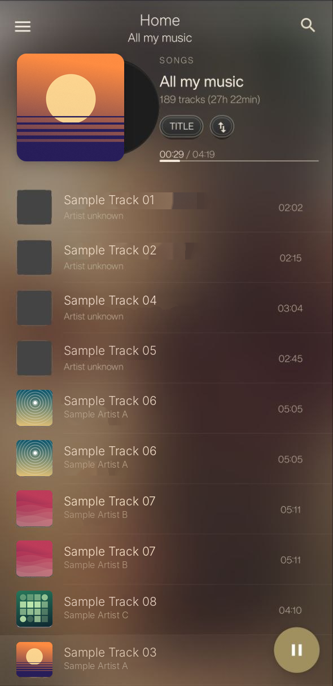 | 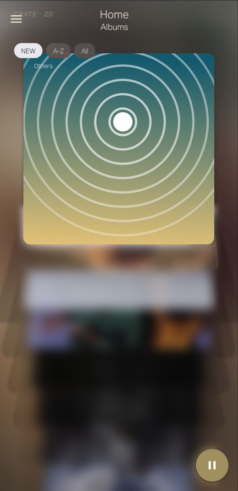 | 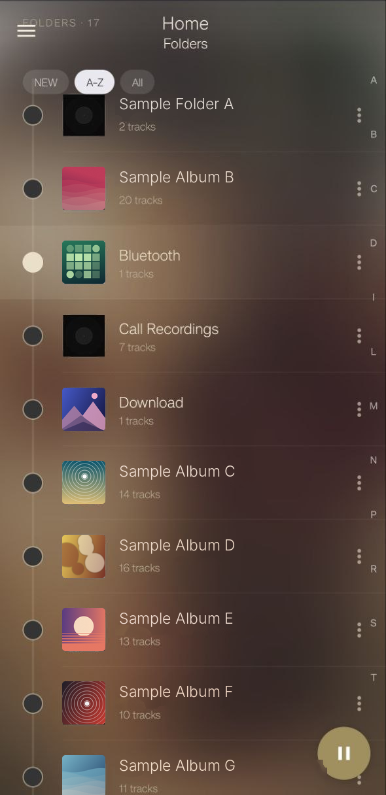 |

| Artists | Genres | Equalizer |
|---|---|---|
| 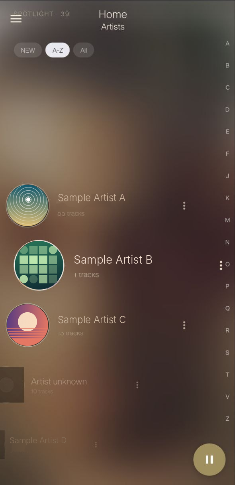 | 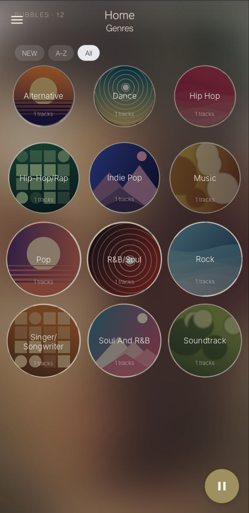 | 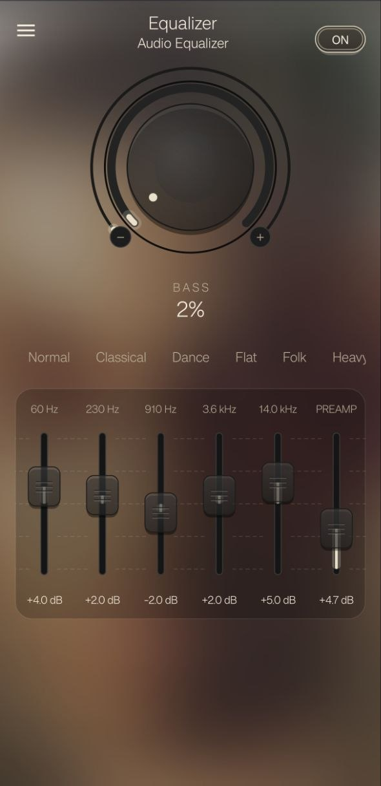 |

| Settings | Drive settings | Notification |
|---|---|---|
| 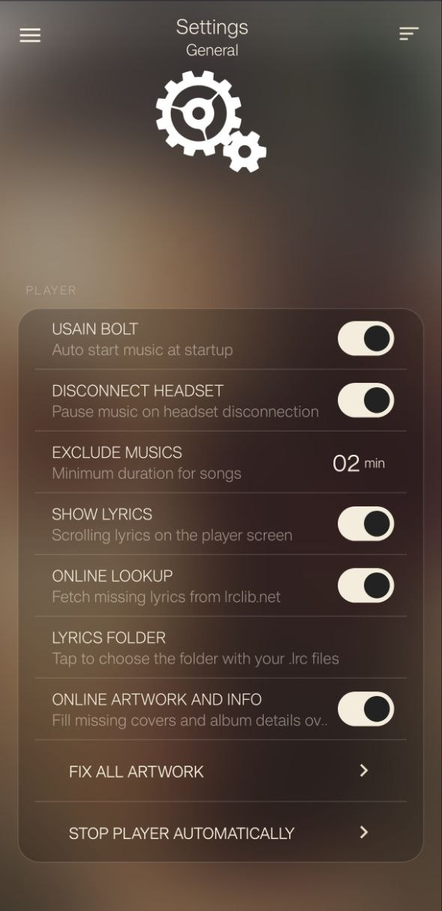 | 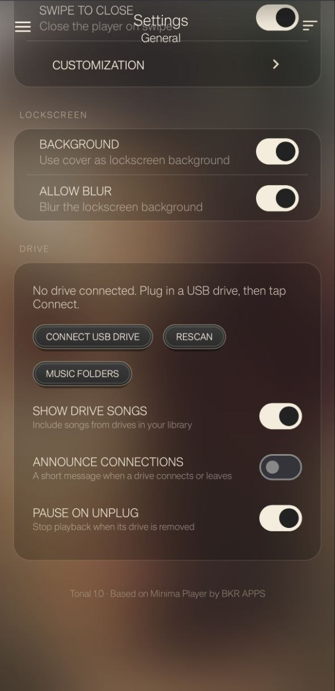 | 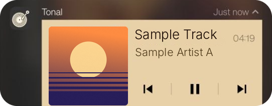 |

Landscape: [Home](docs/screenshots/home-landscape.png), [Albums](docs/screenshots/albums-landscape.png), [Settings](docs/screenshots/settings-landscape.png)

## What Tonal is

Minima Player was a small, elegant player built around a vinyl-style interface. When it stopped launching on modern Android, I rebuilt the project from its decompiled sources, brought it up to date with the current Android toolchain, and then started adding the features and the look I wanted. Tonal is the result.

Since then the inherited, decompiled code has been replaced in stages with new code written from how the app behaves, rather than line by line. See [Rewritten code](#rewritten-code) below.

## What changed from Minima

**Revival**
- Repaired the launch crash and migrated the project to Gradle with the current Android Gradle Plugin.
- Migrated from the old support libraries to AndroidX, and from Glide 3 to Glide 5.
- Replaced a broken decompiled resource set with clean, library-provided resources.

**Reliability and modern Android**
- **Background playback that lasts.** Playback runs as a proper foreground media service, so Android keeps it alive with the screen off or the app swiped away. While music plays, its notification stays on screen; pause it and the notification can be swiped away.
- **Notification controls.** The compact notification has previous, play/pause and next, and its title and cover follow the song that is playing.
- **Fewer crashes.** Fixed duplicate button and call-listener registrations (one press could skip several tracks), crashes when no screen was attached to the service, leftover screen references after rotating, reopening the app or leaving the player and playlist screens, and a crash on relaunch after leaving the player.
- **Fresh installs work.** Permissions are requested to match the Android version: music access, an optional phone-state permission (to pause on calls) and an optional notification permission. An empty or unreadable library now shows the "no music" screen instead of crashing.
- **Current Android target.** The app now targets Android 17 (API 37) instead of API 24. That covered notification channels, foreground-service types, scoped storage, non-exported receivers, immutable pending intents, forced edge-to-edge drawing, the new back-gesture handling and Android 17's background-audio rules (playback and audio focus only run from a foreground media service, which also stays alive across a phone-call pause).

**New features**
- **Live lyrics.** A scrolling, time-synced lyrics view on the player screen. It reads a local cache first, then looks the track up online on [LRCLIB](https://lrclib.net). It also reads a `.lrc` file stored beside the song: directly on Android 10 and older, and on newer versions once you pick your music folder under **Settings → Player → Lyrics folder** (tap to choose, hold to clear).
- **Lyrics settings.** Turn lyrics on or off, and turn the online lookup on or off, independently.
- **Tap to seek, and timing.** Tap any lyric line to jump to it. If a track's lyrics are slightly early or late, nudge them from the player's long-press menu; the adjustment is remembered per track.
- **Sleep timer shortcut.** Set the sleep timer from the same menu without opening Settings.
- **Open with Tonal.** Choose a song in a file manager (tested with MiXplorer and the ColorOS Files app) and Tonal opens on Home with the Player on top and the song playing. Back returns to Home with the music still playing, and reopening Tonal from Recents resumes the same session. Songs that the "skip short songs" setting hides from the library still play this way, as an extra entry at the end of the queue. If a song cannot be identified, Tonal says so and shows the library instead.
- **Equalizer.** A built-in equalizer screen with a bass-boost knob, a row of presets, one fader per frequency band and a preamp fader, plus an on/off switch. Your settings are remembered between sessions, and they apply as soon as music plays, without opening the screen.
- **Online artwork and album info.** Missing album covers, and missing year and genre, can be filled in over Wi-Fi from MusicBrainz, the Cover Art Archive and Deezer. Covers can also be searched, picked from the phone, or reset by hand from the long-press menu. Everything is stored inside the app and never written into your music files.

**New look**
- Material 3 dark theme with a neutral grey palette, restyled switches, dialogs and bottom sheets.
- Higher-contrast text on the Home screen and in the navigation drawer.
- A new "About" screen in place of the old beta page.
- A new app icon (a turntable in charcoal, warm cream and white), also used in the Recents list, and an animated launch screen where the tonearm lands on the record.
- **Stacked Home cards.** The Home categories are a stack of cards: swipe right to left and the front card slides off while the stack shuffles forward. The Home background is a blurred copy of the front card's cover.
- **Its own cover for every card.** All Music shows the cover of the track that is playing (a music note until something has played); Albums, Folders, Artists, Genres and Playlists each have a drawn cover.
- **Record crate.** Albums open as a crate of records: covers overlap, lean back, and tip forward as you scroll.
- **Folder rail.** Folders are a vertical rail like the queue: a small cover, the folder name and its track count on each row, and the folder nearest the top glows with a cream dot and wash as you scroll.
- **Spotlight wheel.** Artists are round photos on a dial: the one in the middle is full size, and the others curve away, shrink and fade. Tap one to roll it to the middle, then tap again to open it.
- **Genre bubbles.** Genres float as bubbles sized by how many tracks they hold. The ones near the middle of the screen swell, like looking through a lens.
- **Cassette tapes.** Playlists are a pile of cassettes with a cream label, and the reels turn as you scroll.
- **Queue screen.** The cover sits on a sleeve with a record peeking out that spins while music plays, next to the current title, artist and time. Below it the queue is a vertical rail: played tracks are dimmed with filled dots, the current track glows, and upcoming tracks have hollow dots. Rows can still be dragged to reorder or swiped away, and Save keeps the queue as a playlist.
- **USB and OTG drives.** Plug in a drive with a USB OTG adapter and its songs join your library, tagged "Drive" in the lists. Drives that Android mounts itself (such as exFAT) appear on their own. For FAT32 drives that Android refuses to mount, Tonal can read the drive directly over USB (Settings → Drive → Connect USB drive), listing its songs, remembering them between plug-ins and streaming them for playback. This direct reader supports FAT32 only and is built on a vendored copy of [libaums](https://github.com/magnusja/libaums) (Apache 2.0) with its newer fixes. Under **Settings → Drive** you can choose which folders hold your music (the rest are ignored), and three switches: show drive songs, announce connections, and pause when the drive is removed. Songs from an unplugged drive are dimmed in the queue.
- **Settings.** One scrolling page of cards (Player, Interface, Notification, Lockscreen, Drive) under the two turning gears, which slide up and fade as you scroll. The toolbar's right-hand button opens a jump-to menu, and the bottom of the page shows the version and the credit to Minima Player by BKR APPS. The timer and notification colour screens still open as their own panels.
- **Player.** The original turning platter and layout, with raised charcoal control keys, a cover-tinted play/pause button with a cream ring, and an outlined Playlist pill.
- **Landscape.** Home, the Player, the Queue and the song lists have their own sideways layouts on phones, and the record crate keeps its covers a sensible size. Details: on Home the card stack takes the full height on the left with the Recently added block beside it, and in the Player the cover and progress ring sit on the left with the lyrics, Playlist pill and control keys on the right. Portrait is unchanged.
- **Landscape browse and Settings.** On phones held sideways, the album crate runs left to right with the front cover at the left and the rest fanned out behind it, and the cassettes slide sideways with the middle tape full size. The artist wheel stays on the left, the genre bubbles use six columns instead of three, and Settings becomes a section list on the left with only the chosen section shown on the right (the toolbar jump button switches section too).
- **Sort pills.** Every browse screen has NEW, A–Z and All pills. NEW puts the most recently added first, A–Z sorts by name (ignoring a leading "The") and shows a letter strip you can drag along to jump (down the right edge in portrait, along the bottom in landscape), and All restores the usual order. The choice is remembered per screen.
- **Browse screens.** Cassettes, the album crate, the artist wheel, the genre bubbles and the folder rail keep their own motion but share one frame: a small caps label with the count (for example "Cassettes · 12"), cream hairline rims on covers and bubbles, charcoal cassette bodies, titles on the top edge of album covers, and the focused item glowing brighter than the rest.
- **Home and All Music.** Home keeps its stack of cover cards over a softened, cover-tinted blur. The category name sits under the stack, above the page dots, and the Recently added rail shows raised covers with a glowing dot on the one on show. The song lists (All Music, albums, artists, genres) share the queue's sleeve and spinning record, a pill for the sort order, raised cover thumbnails, and a cream wash on the playing track.
- Swiping back from the player and from each category screen returns to Home, and a left-to-right swipe from a little in from the left edge opens the navigation drawer.
- Text and icons use a warm cream instead of white, matching the app icon.

## Rewritten code

The app started as decompiled output of Minima Player. It has been replaced in stages, keeping behaviour, preference keys and saved-data formats the same so nothing is lost on update:

1. **Models and helpers.** Songs, playlists, categories, preferences and utility classes.
2. **Adapters, transitions and the navigation drawer.**
3. **Custom views.** Progress ring, cover view, play/pause button, scroll bar and the animated views.
4. **Screens.** Songs, Queue, Player, the Home carousel, song details and Settings.
5. **Core.** The library builder, the foreground playback service and the main activity, including the Open With flow.
6. **Resources.** The package renamed to `com.meccael.tonal`, the cover art and record overlay redrawn, unused resources removed, and the remaining inherited layouts rebuilt.

Still inherited, on purpose or not yet done:
- The English strings and the community translations of them. The translations are the work of Minima Player's contributors and are keyed to the current wording, so they were left as they are. The "could not open that song" message was added later and translated for 108 languages without native review.
- `Fragment_Home_Playlists` and `Fragment_RegulateAudio`.
- Some original class names (`Application_Main`, `ServiceMusic`, `Fragment_ReadyForBeta`), kept so references stay stable.
- Menus, animations and transitions, which are only lists of items and numbers.
- Standard Material-style icon glyphs.

## Design

Tonal is meant to look minimal at first glance, and to show detail only as you scroll or tap.

- **Palette:** charcoal `#343434` and warm cream, with a few darker greys. Text is `#F4ECDC`, icons and accents are `#EADFC8`, and secondary text is `#B9AE98`. This is the palette of the app icon. There are no other accent colours, and no pure white.
- **Each Home card has its own way of browsing** (record crate, folder rail, spotlight wheel, genre bubbles, cassette tapes), but all of them use the palette above.
- New screens and features should follow the same palette and start plain.
- The Home screen runs on Jetpack Compose. The player and the rest of the app remain on classic Views.

## Privacy

Tonal reads music from the device and plays it locally. It has two optional network features, both under **Settings → Player**:

- **Online lookup** (lyrics) sends a track's title, artist, album and duration to lrclib.net.
- **Online artwork and info** sends an album's artist and album name to musicbrainz.org, coverartarchive.org (and archive.org, which hosts the covers) and deezer.com. It runs on Wi-Fi only, and is off until you switch it on.

Turn either one off and Tonal stays fully offline, using local `.lrc` files, the lyrics cache and the artwork already on your device.

## Building

Requirements: Android Studio (current stable), JDK 17 or newer, Android SDK 37.

```
git clone <this repository>
open the project in Android Studio, let Gradle sync, then Run
```

- `minSdk` 24
- `targetSdk` 37
- `compileSdk` 37
- Application ID: `com.meccael.tonal`
- Java package: `com.meccael.tonal` (renamed from the original `pm.minima.android`)

## Project layout

| Path | Contents |
|---|---|
| `app/src/main/java/com/meccael/tonal/application` | Activities, fragments, the music service, Open With |
| `app/src/main/java/com/meccael/tonal/manager` | Library scanning, songs, playlists, the current queue, drive watching |
| `app/src/main/java/com/meccael/tonal/artwork` | Online cover and album-info lookup |
| `app/src/main/java/com/meccael/tonal/usb` | Direct USB drive reading |
| `app/src/main/java/com/meccael/tonal/lyrics` | Lyrics parser, loader and the scrolling view |
| `app/src/main/java/com/meccael/tonal/audio` | Saved equalizer settings |
| `app/src/main/java/com/meccael/tonal/compose` | Compose Home screen |
| `app/src/main/java/com/meccael/tonal/views` | Custom views: the list effects for each Home card (record crate, folder rail, artist wheel, genre bubbles, cassettes) and the equalizer knob and faders |
| `app/src/main/res` | Layouts, themes, drawables, the launcher icon and splash animation |
| `docs/screenshots` | Screenshots used in this README |

## Known issues and roadmap

- Direct USB reading only works with FAT32 drives and can be slow on the first scan of a large drive. The phone may also drop the connection to a drive mid-scan; Tonal keeps what it has read and resumes when the drive comes back. exFAT and NTFS drives only work when Android mounts them.
- On Android 11 and newer, `.lrc` files beside songs are only found after you choose your music folder under Settings → Player → Lyrics folder; without it, Tonal uses the lyrics cache and the online lookup.
- A brief visual glitch can occasionally appear when returning from the player; it has not been reproduced reliably yet.
- Possible later work: further polish. The Home carousel is still driven by a legacy pager adapter behind the Compose screen.

## Acknowledgements

- **BKR APPS**, for Minima Player and its original design.
- **Minima Player's community translators**, whose translations Tonal still ships.
- **Magnus Jahnen and the libaums contributors**, for the USB mass storage library behind direct drive reading (Apache License 2.0).
- **LRCLIB**, for the free synced-lyrics API.
- **MusicBrainz, the Cover Art Archive and Deezer**, for the artwork and album lookups.
- The Android, Material, Glide and Jetpack teams for the libraries this builds on.

## Licence and credits

Tonal's own code, artwork and text are released under the [MIT License](LICENSE). That does not cover what is still inherited from Minima Player, which remains the work of BKR APPS. See [NOTICE.md](NOTICE.md) for the details and the third-party components.

Tonal is an unofficial fork. The original app has been abandoned for years and Minima Player's author could not be reached for permission, so this is published in good faith with full credit. If you are BKR APPS or a rights holder and want something changed or removed, please get in touch and it will be handled promptly.

There is no prebuilt APK here. Build it yourself with Android Studio or `./gradlew assembleDebug`. On newer Android versions, installing apps you built yourself may need a free developer account or the "install unverified apps" flow in system settings.

Tonal is provided as is, without warranty. It is a personal, non-commercial project.
